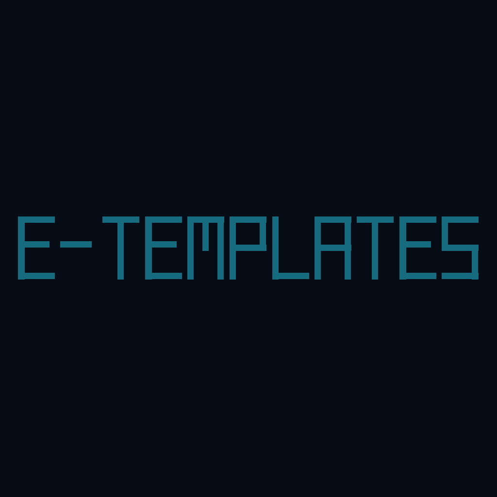

# e-templates

<p align="center">
  
</p>

Collection of **e-stack** project templates plus the tooling that keeps them honest.
No Python project lives at this root: every project is a self-contained system under `systems/`,
infrastructure stacks under `stack/`, CI/CD sources under `infra/`, and the generator itself under
`management/`. Four areas, one style: materialize over import, drift-gate over trust, gates as code.

##### SYSTEMS — the templates #####

Each is an independent uv project with its own `pyproject.toml`, `Makefile`, tests, docs and CI/CD.
App vs library is what changes, not the rules: `ruff · ty · tach · pytest+coverage · strict docs ·
zizmor`, git-tag releases, all publishing gates inert by default.

- `systems/core` — **e-core**: the shared source of truth. Layered settings composer, structured logger,
  crypto engine, state, ops file discovery, service adapters. Services do not import `e_core` — they
  **materialize** it. Edit shared code only here, never in a service's `src/core/`.
- `systems/api` — **e-api**: Litestar + Granian API service template, msgspec end to end.
- `systems/graph` — **e-graph**: LangGraph runtime, rustworkx topology, React Flow canvas over
  Litestar + Granian (api + canvas).
- `systems/mcp` — **e-mcp**: in-process `MCPServer` over Streamable HTTP, granian factory, bearer gate
  on loopback.
- `systems/cli` — **e-cli**: cyclopts on uv, lazy declarative commands, typed injection, undo journal.
- `systems/tui` — **e-tui**: config-driven responsive layout mini-framework over Textual, fillable
  static/dynamic frames, snapshot gallery.

##### STACK — the services #####

Self-hosted infrastructure, one folder per service: `stack/<category>/<service>/compose.yml`, with its
configs, entrypoints and assets beside it. Categories by role: databases by data model (`rdb`, `cdb`,
`vdb`, `gdb`, `ddb`, `tdb`), infra (`queue`, `proxy`, `auth`, `watch`, `storage`, `llm`, `speech`, `rag`,
`mem`, `agent`, `front`, `media`, `tools`). One shared network `stack`; services see each other by
hostname. Upstream default ports, explicit overrides. `:latest` unless the tag fixes a format.
Indivisible pairs are `include`d and health-gated. Details in `stack/README.md`.

##### INFRA — CI/CD as source #####

`infra/` is to every project's `.github/` what `systems/core` is to `src/`: the source of truth,
materialized and assembled — a feature map (`features.yml`), atomic jobs, workflow shells with token
slots, one-time install instructions, and the generated contract test (`test_ci_contract.py`) that
validates manifest vs workflows in both directions. No workflow is hand-written twice; no CI edit
drifts unseen (`make infra-check`).

The repo dogfoods it: `make maintain` assembles every `.github/` — the systems' and its own — from
`infra/`, and `repo-maintain` keeps the three mutable areas honest: Renovate opens PRs for `systems/`
deps, `stack/` images and the action pins in `infra/`; `sync-systems`/`sync-stack`/`sync-infra` follow
each area; `health-areas` reports stack · systems · infra monthly; `maintenance` mends what a bump breaks.
Every maintenance line lands in `CHANGELOG.md` under its area.

##### MANAGEMENT — the tool that launches new ones #####

`management/` (e-management) inspects, materializes and generates. The wizard is the front door:

```bash
make manage            # open the Textual wizard — same as uv run --project management python -m e_management
```

The wizard walks the boilerplate: pick the project kind (api · graph · mcp · cli · tui), name, layout,
optional features, CI/CD section assembled from `infra/`, then materialize core/ops/common and write
the project. Headless subcommands cover the same surface: `plan`, `gen`, `drift`, `graph`, `stack`,
`map` — every verb both a CLI command and a TUI action, one deterministic engine behind both.

```bash
cd systems/api && make install   # materializes core/ops/common, syncs deps, installs git hooks
make -C systems/api check        # lint + type + arch + validate + drift + tests
make -C systems/api ci           # every CI gate in one command
make update                      # re-materialize systems/api from its sources (core + common)
make drift                       # report materialized drift across the whole ecosystem
```

`make` (no target) lists every command in any project.
